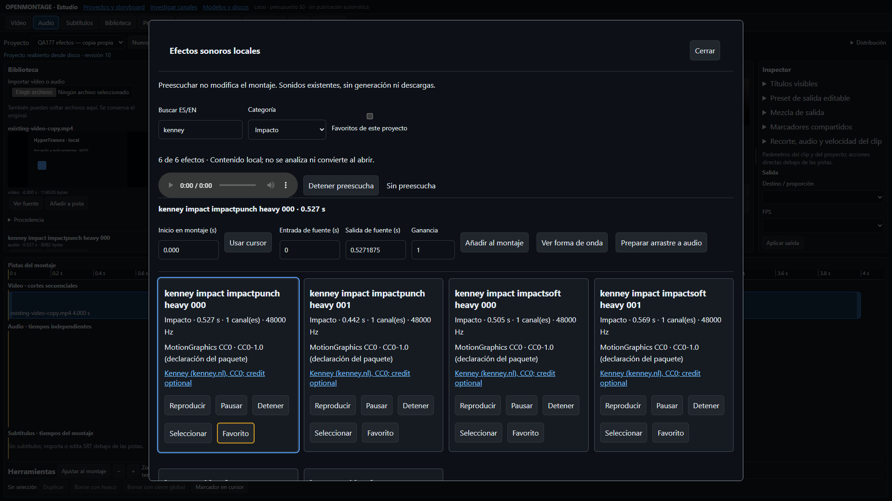

# Catálogo visual de efectos sonoros locales (#177 / #174)

Implementación sobre Audio y la timeline existentes, compartida con el agente. Sin sintetizar sonidos, instalar paquetes, descargar bibliotecas ni tocar modelos. La activación principal sigue agrupada; esta entrega se comprobó en Studio QA4768 con configuración/proyectos separados.

## Biblioteca preparada

Se reutilizó el ZIP local de `Barty-Bart/motion-graphics`, revisión **3d83d987d658601d8a1269eb691622bdcd427335**. Free Download Manager registraba su descarga terminada; identidad/metadatos se conservaron durante la preparación. Se contrastaron una vez **109 OGG / 109 contenidos únicos / 2.381.752 bytes** y `LICENSES.md` con sus blobs oficiales. No se ejecutaron scripts del paquete ni se extrajeron todos sus recursos. El SHA256 de cada OGG es calculado localmente; la referencia oficial utilizada es el **Git blob**, no un SHA256 publicado por el proveedor.

[Manifest oficial fijado](sfx/motion-graphics-official.json) · [109 efectos con hashes/metadatos/procedencia](sfx/motion-graphics-catalog.json).

Los 109 medios tienen declaración **CC0-1.0** en [LICENSES.md fijado](https://github.com/Barty-Bart/motion-graphics/blob/3d83d987d658601d8a1269eb691622bdcd427335/skills/sound-effects/LICENSES.md), con autor, URL original y transformaciones. Se conserva esa evidencia; no se afirma haber revalidado independientemente todas las páginas Freesound. Se excluye la descarga opcional Mixkit: no es uno de los 109 OGG empaquetados. No se utiliza el API Freesound.

Sonniss, ANVEAI-MotionPack y los tres OGG sueltos llamados como páginas Kenney **no se registraron como bibliotecas completas**. Requieren revisar su preparación/licencia específica. No se analizaron audios Sonniss ni se ampliaron permisos para IA. Sus ZIP/originales permanecen intactos.

## Ventana y edición

En Audio, **Efectos sonoros · catálogo** abre una ventana amplia con tarjetas: nombre, categoría ES/EN, duración, canales/frecuencia, biblioteca, licencia y autor/fuente. Búsqueda local sin modelo, por nombres/categorías/autores y sinónimos comunes (por ejemplo `puñetazo fuerte`); no es búsqueda semántica del audio. Filtros por categoría y favoritos **de este proyecto**. Primera página de 24 tarjetas; **Mostrar más** carga metadatos progresivamente.

- **Reproducir / Pausar / Detener** son independientes de **Seleccionar** e insertar. Una sola preescucha SFX; al reproducir B se sustituye A. Cerrar detiene el audio. Preescuchar no modifica revisión ni montaje.
- **Ver forma de onda** decodifica solo el efecto seleccionado, reutiliza el renderer de waveform existente y mantiene una caché pequeña por SHA. Abrir la ventana no convierte ni decodifica toda la biblioteca.
- **Seleccionar** muestra inicio en montaje, entrada/salida de fuente y ganancia. **Usar cursor** prepara el inicio y recorte disponible; se muestran los tiempos antes de insertar. **Añadir al montaje** crea un clip real en audio. Se admiten clics cortos: mínimo 1 ms, sin imponer un fotograma de vídeo al audio.
- **Preparar arrastre a audio** cierra la ventana y enfoca el control externo del efecto seleccionado. Arrastrarlo a la pista de audio inserta en la posición de caída, utilizando la misma operación. Así el destino no queda cubierto por la ventana modal. La posición/recorte usados se informan después; al arrastrar, la salida se limita al final del montaje. El motor de audio existente redondea el inicio a milisegundos.
- Recorte, posición, ganancia y fades se editan después con los controles ya existentes. Deshacer/rehacer, guardar/reabrir y procedencia pertenecen al mismo proyecto; no hay otra timeline.

El primer uso prepara en caché **solo un OGG** desde el ZIP verificado, sin rehashear el paquete. La copia inmutable dentro del proyecto ocurre únicamente al insertar; varias inserciones del mismo contenido reutilizan una fuente y una atribución. Deshacer conserva el archivo, y una nueva inserción explícita puede reutilizarlo verificando su identidad. El original ZIP y su licencia no se sobrescriben.

## Agente y recuperación HTTP

`studio_project_edit` añade `sfx_catalog`, `sfx_insert` y `sfx_receipt`. Catálogo y agente usan los mismos IDs `sfx-<sha256>`.

```json
{"project_id":"ID_PROYECTO","action":"sfx_catalog","sfx":{"q":"impacto","category":"impact","limit":24}}
```

```json
{"project_id":"ID_PROYECTO","action":"sfx_insert","sfx":{"request_id":"ID_UNICO_DE_AL_MENOS_16_CARACTERES","revision":12,"asset_id":"sfx_SHA_REEMPLAZAR_POR_ID_DEL_CATALOGO","start_seconds":1,"in_seconds":0,"out_seconds":0.3,"gain":0.5}}
```

El segundo ejemplo exige sustituir el ID ilustrativo por un ID real del catálogo (`sfx-` seguido de 64 hexadecimales). La inserción es una transacción con revisión y un recibo persistente en el mismo artefacto de edición. El mismo request_id con parámetros idénticos recupera el resultado, incluso si la revisión enviada quedó antigua o luego se deshizo; no vuelve a insertar. Reutilizarlo con otros parámetros devuelve conflicto. Las mutaciones de usuario/agente respetan el mismo guard de trabajo activo.

Tras respuesta incierta, usar `action:sfx_receipt` y `request_id`, o **Recuperar inserción** en la ventana. Se conserva el token y formulario. Un GET 404 confirmado permite preparar explícitamente una nueva solicitud; no hay reenvío automático. El favorito usa el comando revisionado `sfx_favorites` con `ids`, modifica metadatos del proyecto y no invalida su render.

## Validación y límites

- **11 casos nuevos focalizados** aprobados: catálogo sin leer/extractar audios, idempotencia/conflictos, fuente/licencia única, undo/redo/reapertura, nueva inserción tras undo, errores atómicos, favoritos aislados por proyecto, caché/unidad ausente, reutilización sin hash, puente agente/API, límites OGG, clics cortos y búsqueda ES. Algunas condiciones comparten caso. Se repitió solo el caso de límites afectado al corregir el mínimo de audio; no otras pruebas aprobadas.
- Studio real QA4768: primera página 24/109; A/B con audio nativo decodificado, pausa/detención y sin mutación; búsqueda, waveform real, favorito, insertar, deshacer/rehacer, guardar/reabrir y ajustar ganancia/fades. Se perdió deliberadamente **la respuesta** de una segunda inserción que sí se confirmó en el backend; recuperar el recibo no envió otro POST.
- El primer helper de navegador llegó a esas comprobaciones y falló al intentar arrastrar directamente desde la ventana modal; no se declaró aprobado entero. Se separó el control externo y se probó solo el arrastre pendiente con eventos nativos reales: una tercera inserción. Resultado: **3 clips, 1 OGG congelado, 1 licencia y 3 recibos**. Caché de preescucha: 3/109 OGG usados, no extracción completa.
- Una **sola exportación nueva** de 4 s reutilizó el MP4 propio existente y el efecto seleccionado: 640×360, 8 FPS, 32 fotogramas, audio 4 s / 192.000 muestras. Correlación PCM prevista frente a AAC decodificado **0,999969**; energía residual del SFX dentro/fuera de sus intervalos **2947,6×**. Chrome reprodujo el export con vídeo/audio decodificados y sin error. No se repitieron pilotos, ASR, síntesis ni renders aprobados. Un primer helper pulsó exportar antes de hidratar el proyecto: no creó trabajo; se comprobó estado `idle` antes de iniciar la exportación válida, sin reintento ciego.
- Tres OGG usados fueron contrastados con FFprobe: duración/canales/tasa coinciden con metadatos de cabecera. Se inspeccionó la captura de la ventana. **Escucha humana pendiente**.
- Otro caso real de navegador rechazó una inserción fuera de duración: GET del recibo confirmó 404 antes de habilitar una nueva solicitud explícita. Formulario intacto, ningún reenvío automático, Esc cerró y devolvió foco al botón del catálogo.

Favoritos por cuenta y permisos multiusuario completos de #168 siguen pendientes; no se simula una separación de cuentas con etiquetas. Estos favoritos pertenecen al proyecto actual. No se declara incorporado Sonniss ni todos los archivos sueltos de SFX, ni completado todo #174/#177. Errores de archivo/unidad/caché se muestran sin descargas o reparación automática.

[Evidencia estructurada](CATALOGO_SFX_EVIDENCIA_20261126.json). Studio 4750 se conserva; activación agrupada pendiente. `.venv`, ComfyUI, configuraciones anteriores y originales conservados. PR #2 continúa en borrador. Las ocho descargas LongCat/Wan siguen en espera explícita de confirmación; no se consultaron sus carpetas nuevas.


