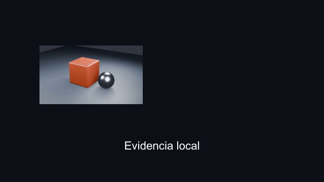
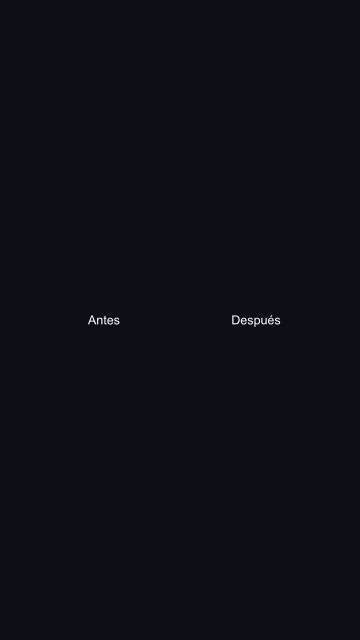

# Componentes editables propios

Adaptación acotada #146/#147, no integración completa de Koubo/Vox-Director.
Código propio sobre títulos, capas y FFmpeg de Studio, sin copiar componentes
de terceros, instalar otro motor ni usar Atlas/Renoise.

En Vídeo/Biblioteca → «Componentes editables locales»: tarjeta de evidencia con
etiqueta de fuente, comparativa de dos textos o collage de1–2vídeos registrados.
Elegir tiempos, procedencia y perfil de zona segura. El collage requiere fondo
limpio de intervalos vacíos: no difumina un póster con el sujeto todavía visible.
Son recortes rectangulares de vídeo, no segmentación automática ni máscaras PNG.

El preset se expande en títulos/capas reales del mismo EDL. Sus botones abren
los controles existentes: texto/tamaño/posición/ancla horizontal/tiempos y
selección/encaje/posición/tamaño/opacidad de capa. Movimiento lineal dx/dy por
tiempo absoluto; un ripple conserva la fase y no reinicia la animación. Sin
easing, cámara o eliminación automática de fondo prometidos.

El agente usa `studio_project_edit`, comando `component_add` con `kind`:
`evidence_card`, `comparison` o `collage`; `component_remove` quita el grupo sin
borrar recursos. Requiere revisión; mismos comandos `title_update`/`layer_update`
y deshacer/rehacer/guardar que el usuario. Procedencia declarada y derechos
quedan en `component_origin`, no se transforman en hechos verificados.

Perfiles YouTube/TikTok/Facebook/Instagram definen insets normalizados
conservadores, no validación permanente de las interfaces de esas plataformas.
El texto se envuelve y ajusta al espacio vertical; revisar tras cambios manuales
o de ratio. La revisión del renderer invalida solo cachés con componentes,
conservando las de montajes tradicionales sin esta función.

QA: una escena propia de4s reutiliza el vídeo Blender ya aprobado y un WAV
español Piper existente con sus atribuciones. No nueva síntesis ni piloto.
Elementos repartidos en el tiempo para evitar solapamiento: tarjeta0–1,25s,
comparativa1,25–2,5s y collage2,5–4s. H264/AAC640×360,96fotogramas, decodificación
completa sin errores. Formulario real cambió X de capa; undo/redo/save/reopen y
exportación/reproducción reales en Chrome e instancia aislada actualizada.
Fondo limpio y ausencia de persistencia de la capa fuera de su tiempo comprobados
en muestras; no se afirma inspección humana de todos los fotogramas.

Cuatro pruebas raster estáticas16:9/9:16/4:5/1:1 con el mismo renderer ASS y
escena verifican la comparativa; no son cuatro exportaciones audiovisuales ni
garantía de todos los textos posibles.13 pruebas nuevas focalizadas, incluida
fase tras ripple, límites, contratos de caché y persistencia.
Escucha humana, activación4750 y variantes audiovisuales completas pendientes.

