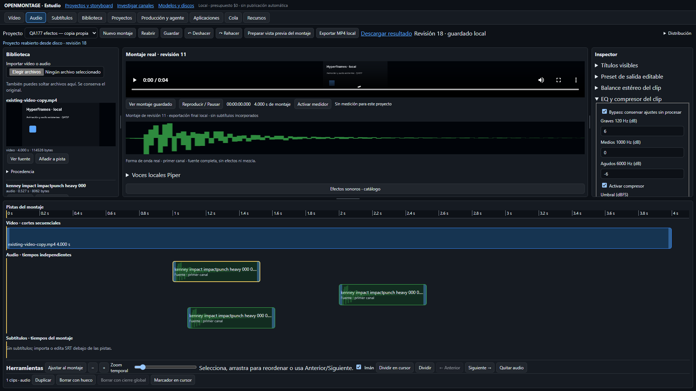

# EQ de tres bandas, compresor y bypass por clip (#174)

Extensión local de la cadena del mismo clip editable por usuario y agente. Se reutiliza FFmpeg y los controles de ganancia/fades/mezcla existentes; no se añaden paquetes, modelos ni otra timeline. Alcance **por clip**, no buses de pista ni un mezclador Fairlight completo.

Selecciona vídeo con audio o un clip de audio. En **EQ y compresor del clip**:

- EQ de campana, una octava de ancho, centrada en 120/1000/6000 Hz. Cada banda admite −12…+12 dB; 0 no añade filtro. No son controles de shelf ni un ecualizador paramétrico completo.
- Compresor opcional: umbral −40…−6 dBFS, ratio 1…20, ataque 2…200 ms y release 20…2000 ms. Sin makeup automático. Ratio 1 no procesa.
- **Guardar cadena** persiste todos los parámetros. **Guardar y alternar bypass** guarda también el borrador y cambia bypass conservando los ajustes. **Quitar cadena** elimina el efecto, incluso si un borrador numérico no guardado es inválido. Las operaciones son reversibles.

La cadena aplica conversión estéreo existente → balance → EQ → compresor → ganancia/fades → mezcla/normalización/limitador existentes. Los coeficientes se construyen con números validados, sin expresiones arbitrarias de usuario. Se rechazan fuentes sin audio, huecos, clips bloqueados, booleanos usados como números, valores no finitos, parámetros desconocidos o fuera de límites.

Los filtros son [equalizer y acompressor de FFmpeg](https://ffmpeg.org/ffmpeg-filters.html). El estado del filtro dinámico se reinicia por clip: no equivale a compresión continua de un bus. Dividir/ripple conserva parámetros y reloj del montaje, pero no promete conservar el estado interno del compresor entre segmentos.

## Agente e identidad

Capability/comando `audio_processing`, a través del mismo `studio_project_edit` y revisión:

```json
{"operation":"audio_processing","revision":12,"track":"audio","id":"ID_CLIP","processing":{"bypass":false,"eq":{"bass_db":6,"mid_db":0,"treble_db":-6},"compressor":{"enabled":true,"threshold_db":-18,"ratio":4,"attack_ms":5,"release_ms":100}}}
```

`processing:null` quita la cadena. No usar `clip` con un campo desconocido: el comando específico y su capability permiten detectar backend antiguo. UI/API usan el mismo objeto normalizado en la EDL, historial y procedencia del comando.

La identidad de render incluye **solo los ajustes activos** y el contrato `clip-eq3-compressor-v1`. Parámetros preparados con compresor desactivado, una cadena neutra o bypass no invalidan audio idéntico. Activar cambia el digest; bypass recupera el digest sin procesar, conservando los ajustes en el documento. Esto permite volver a un render guardado compatible sin repetirlo.

Para escuchar el cambio hay que preparar la vista previa del montaje; la fuente original y su waveform no llevan esos efectos. El botón no promete DSP ni A/B en directo. `Ver montaje guardado` puede recuperar un render existente que coincida; al activar procesamiento hace falta una salida nueva. Tras HTTP10054, recuperar estado antes de repetir la escritura.

## Pruebas nuevas y alcance de la evidencia

- **6 casos nuevos focalizados** aprobados: persistencia/undo/redo/reapertura y bypass, errores/locks sin mutación, orden y mismo grafo de preview/export, parámetros desactivados sin invalidar render/división, comando del agente/API y contrato efectivo. Sin repetir las pruebas anteriores de balance, keyframes, crossfade ni SFX.
- Cuatro señales PCM sintéticas **nuevas** de 0,5 s comprobaron los filtros reales: ganancia a 120 Hz **+5,99858 dB**, a 6000 Hz **−5,99883 dB**, y relación RMS comprimido/original **0,37684**. Bypass no añade filtros. Sin voz ni vídeo generados. Script opt-in reproducible: `python -m scripts.validate_studio_audio_processing`; no es necesario repetirlo tras esta aprobación.
- Panel y API **reales en QA4769**, copia separada del proyecto SFX ya aprobado: guardar parámetros, alternar bypass, deshacer/rehacer, quitar aun con borrador inválido, guardar/reabrir y conservar ajustes bajo bypass. Se recuperó la identidad del render existente sin volver a renderizarlo. Ningún error de página.
- Mezcla completa real de la copia, procesada a **PCM en memoria**, con EQ/compresor activos solo en una EDL temporal: **192.000 muestras / 4 s**, pico **0,95** por el limitador final existente. La energía del cambio dentro/fuera del intervalo modificado fue **200,64×** al comparar con el render SFX aprobado reutilizado como referencia. El proyecto persistido no se modificó con esa prueba.
- Se inspeccionó la captura del panel. **No se generó otro MP4 con EQ/compresor**, no se volvió a escuchar/reproducir el SFX como prueba aprobada, y la exportación audiovisual codificada con esta cadena y la escucha humana permanecen pendientes. PCM real no equivale por sí solo a esa validación.

[Evidencia estructurada](EDITOR_EQ_COMPRESOR_EVIDENCIA_20261126.json). QA4769 cerrado al terminar. Activación principal agrupada pendiente por el rechazo de política anterior, sin reiniciar Studio4750 ni eludirlo. PR#2 sigue en borrador. Buses, automatización de volumen, ducking, mezcla/A-B en vivo y el resto de #174 continúan pendientes. Se corrigió además el texto histórico del panel que aún declaraba ausentes funciones ya implementadas; la disponibilidad sigue condicionada por capabilities.


