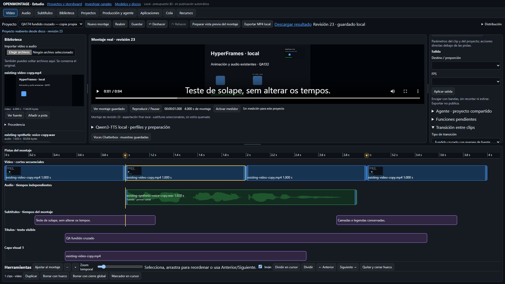
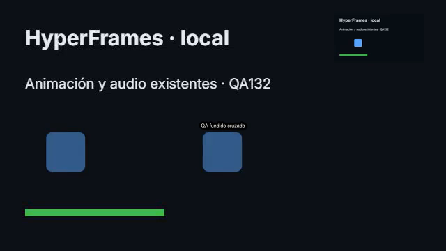

# Fundido cruzado real con margen de fuente (#174)

Entrega para clips principales del mismo proyecto editable por Studio y agente. Reutiliza FFmpeg, el renderer local, revisión optimista, procedencia e historial. No requiere modelos, instalaciones ni recursos nuevos. No sustituye el paso por negro existente.

## Uso y reloj

Selecciona el segundo clip o uno posterior. En **Transición entre clips**, elige **Fundido cruzado con margen de fuente**, indica la **duración total del solape** y aplica. El backend redondea al número par de fotogramas más cercano, entre dos fotogramas y dos segundos. **Quitar transición**, deshacer y rehacer son operaciones reales.

El corte nominal permanece en B. Un solape de duración D ocupa **B−D/2 … B+D/2**. El renderer lee D/2 segundos de montaje adicionales después de la salida del clip anterior y antes de la entrada del siguiente; multiplica ese margen por la velocidad correspondiente para obtener tiempo de fuente. No ofrece congelado como sustituto de un margen rechazado. Se conserva el ajuste al último fotograma del renderer existente; la disponibilidad se calcula con la duración registrada de la fuente. Fuentes con pistas de audio/vídeo de distinta duración requieren revisión adicional. Los recortes guardados, duración total y posiciones de audio independiente, capas, títulos, cues y marcadores permanecen intactos.

Los márgenes contienen imagen y audio **fuera del recorte seleccionado**: revisarlos antes de exportar. Pueden revelar palabras o material que se había excluido. No se inventan transcripciones para esos márgenes ni se acredita protección automática de palabras. Los subtítulos conservan sus tiempos nominales; el fundido no los reescribe.

Se rechazan huecos, margen insuficiente de cualquiera de las dos fuentes, ventanas que exceden el clip, clips bloqueados y fades individuales en cualquiera de los clips que participa en un fundido. Quitar esos fades o ajustar recortes explícitamente; nunca se descartan decisiones en silencio. La primera versión exige FPS divisor de 48000 para que cada mitad se alinee con muestras de audio: 24/25/30/60 están admitidos; no todos los FPS personalizados. Se conserva el límite y la semántica originales de `dip_black`.

## Contrato del agente

Capability `crossfade`, además del comando `transition` ya existente:

```json
{"operation":"transition","revision":23,"id":"ID_CLIP_ENTRANTE","type":"crossfade","duration_seconds":0.5}
```

La EDL guarda `type:crossfade`, duración cuantizada, `alignment:center_source_handles` y `audio_curve:linear`. `type:none` la elimina; `dip_black` conserva duración **por lado**. `studio_project_edit` usa el mismo comando revisionado, sin escritura paralela directa en disco. Ante HTTP10054, recuperar estado/recibo antes de repetir; las pruebas reales no reintentaron escrituras a ciegas.

## Motor y corrección encontrada

Se normalizan formato, resolución, FPS y timebase para [xfade](https://ffmpeg.org/ffmpeg-filters.html#xfade). El audio base usa [acrossfade](https://ffmpeg.org/ffmpeg-filters.html#acrossfade) lineal, con las mismas ventanas. Las capas y el audio independiente se componen después, en su reloj original; títulos y subtítulos siguen la ruta existente. Preview y export usan el mismo plan temporal, aunque puedan tener distinta resolución.

La prueba nueva encontró un fallo al alternar `xfade/acrossfade` con un corte directo: audio de **3,983604 s** frente a vídeo de 4 s. Hacer exacto el número de muestras de cada entrada no bastó: quedaron paquetes con PTS solapados. La solución acotada normaliza **timebase y PTS por muestra después de cada unión**, además de recortar las entradas por muestras. Resultado: 192.000 muestras estéreo con PTS continuos y audio final de **4,000000 s**. No se cambió el mezclador ni el grafo de proyectos sin fundido cruzado.

Un contrato de render específico, `crossfade-centered-source-handles-sample-v1`, identifica esta semántica solo cuando hay fundidos cruzados. Eliminar el último recupera el grafo e identidad de render sin fundido; no invalida renders ajenos a esta función.

## Evidencia y límites

- **9 pruebas nuevas focalizadas** aprobadas por casos, sin suite completa ni CI repetida: tiempos y otras pistas, undo/redo/reapertura, errores atómicos/locks/márgenes/fades/huecos, velocidad/cuantización/ventanas, joins mixtos preview/export, agente/API, muestras exactas, contrato de render y restauración del grafo sin crossfade. Una de ellas ejecuta FFmpeg con señales lavfi pequeñas y verifica PTS continuos; no escribe vídeo. El primer intento de comparar grafos completos falló porque preview y export tienen resoluciones distintas; se corrigió esa expectativa y se repitió solo ese caso fallido.
- **Studio real aislado en 4767**, con proyectos/configuración separados: cuatro clips, dos fundidos y un corte directo; una capa, título, dos cues, marcadores y una muestra sintética ya existente como audio independiente. Chrome aplicó los controles reales, deshizo/rehízo y guardó/reabrió. Otras pistas permanecieron iguales. No se interceptó la API.
- Se hicieron **tres intentos nuevos de exportación de cuatro segundos de la misma escena QA**: los dos primeros documentan el fallo de PTS; se conservan sin acreditarlos. El tercero valida la corrección. No se repitió el piloto HyperFrames, ASR, síntesis ni renders previamente aprobados. Solo se reutilizó su MP4 existente y una muestra Qwen ya guardada; originales conservados.
- Export final: 640×360, 8 FPS, 32 fotogramas con PTS de 0 a 3,875 s, audio 4 s y dos cues seleccionables conservados en 0,250–1,250 y 2,750–3,750 s. El punto medio coincide con mezcla 50/50 de los dos instantes fuente en dos regiones: MAE RGB de **0,701 y 0,884 /255**, bajo umbral previo 3. No acredita igualdad universal de píxeles.
- Voz independiente a 1 s: correlación **0,996925**, desfase **0 ms** en búsqueda a pasos de 1 ms. El primer método de correlación directa no aislaba la voz tenue del fondo y no se utilizó como aprobación. Se restó el fondo PCM calculado con la voz silenciada solo en memoria, sin otro MP4, y se comparó con la muestra existente tras el procesamiento de tempo/resample ya utilizado. No hubo nueva síntesis ni ASR.
- Chrome reprodujo el export desde **Ver montaje guardado** y **Reproducir/Pausar**, decodificando vídeo y audio sin errores. Se inspeccionó el fotograma de mezcla y el panel real. **Escucha humana pendiente**; no se declara validación española del #107 ni revisión de palabras de voz real.

[Evidencia estructurada](EDITOR_FUNDIDO_CRUZADO_EVIDENCIA_20261126.json). Studio 4750 no se detuvo ni reinició. Solo se reciclaron los procesos QA propios para cargar las correcciones y se cerraron al terminar. Activación principal agrupada con keyframes, balance estéreo e HyperFrames, pendiente por el bloqueo de política anterior; no se intentó eludirlo. PR #2 continúa en borrador; #174 conserva el resto de sus criterios pendientes. Las ocho descargas LongCat/Wan siguen en su tabla, sin inventario ni hashes repetidos.

Panel real de QA, con el export corregido y subtítulos seleccionables en reproducción:



Fotograma exportado en el punto medio: ambas posiciones del cuadro azul son la mezcla esperada de instantes distintos, no una capa fantasma fuera de intervalo. La capa pequeña superior derecha y el título se conservan:


